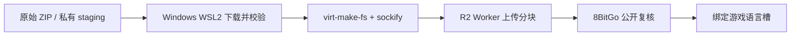

# Windows 豆包制作节点：下载、制盘、上传与绑定

这套流程把大型 DOS / Win95 游戏的重任务放到你的 Windows 高性能电脑，生产机只继续提供网站和 R2 Worker。
豆包在 **WSL2 的 Ubuntu 终端**里执行命令；它不需要登录生产服务器，也不应看到令牌明文。

## 工作方式



`scripts/sockdrive-external-agent.mjs` 是单一入口。它在下载时校验字节数和 SHA-256，制作后复用现有发布器校验每个分块的编码，最后才调用已有绑定接口。`sockdrive.metaj` 依然最后上传，所以中断最多留下未引用的分块。

## 一次性准备

1. 在 Windows 安装 WSL2 和 Ubuntu 24.04，并在 Ubuntu 的 Linux 文件系统内准备工作目录。不要把工作目录放在 `/mnt/c`，NTFS 跨层 I/O 会显著拖慢数千个分块文件的制作。
2. 进入仓库，安装与生产一致的 Node.js 22，再安装制作工具：

```bash
sudo apt update
sudo apt install -y guestfs-tools qemu-utils qemu-system-i386 7zip brotli
sudo chmod +r /boot/vmlinuz-*
mkdir -p ~/8bitgo-work/sockdrive
```

3. 下载与站内 js-dos 版本匹配的 Linux 版 Sockdrive CLI，保存为 `/opt/sockdrive/cli` 并赋予可执行权限。
4. 从 `scripts/sockdrive-agent.example.json` 复制出一个私有任务配置，例如 `~/jobs/aoe2-zh.json`。该文件不放令牌，但其中的 SHA-256 必须是**原始 ZIP**的值。
5. 在 Windows 本地安全保存两个环境变量，不写入 JSON、Git、豆包聊天或命令行参数：

```bash
read -s SOCKDRIVE_WORKER_TOKEN
export SOCKDRIVE_WORKER_TOKEN
read -s EIGHTBITGO_ADMIN_JWT
export EIGHTBITGO_ADMIN_JWT
```

`SOCKDRIVE_WORKER_TOKEN` 用于读取私有 staging 和上传分块；`EIGHTBITGO_ADMIN_JWT` 只用于最后的游戏绑定。令牌泄露时应立即在服务端轮换。

## 交给豆包的任务

在 Windows 的豆包编码助手中打开仓库，并把下面这段交给它。令牌已经在 WSL 环境变量中时，不要把它们粘贴进对话。

```text
在 WSL2 Ubuntu 中执行 8BitGo Sockdrive 外部制作任务。
只运行下面的命令，不要显示、读取或修改任何令牌环境变量，不要提交 Git：

npm run sockdrive:agent -- --config ~/jobs/aoe2-zh.json

完成后报告生成的 Sockdrive 前缀、上传结果和绑定结果。若失败，保留工作目录和 source.zip.part，不要删除或覆盖已有版本目录。
```

首次执行会完成“下载 → 制作 → 上传 → 绑定”。任务中断后再次运行相同命令会：

- 从 `source.zip.part` 续传；若源站不支持 Range，会安全地从头下载；
- 复用已经完成的本地 `publish/` 目录；
- 重试上传或幂等绑定；
- 拒绝覆盖已有的公开 Sockdrive 版本目录。

只想先观察制作结果而不上传时：

```bash
npm run sockdrive:agent -- --config ~/jobs/aoe2-zh.json --prepare-only
```

制作完成后只补传和绑定时：

```bash
npm run sockdrive:agent -- --config ~/jobs/aoe2-zh.json --upload-only
```

## 配置字段与接口

| 字段 | 用途 |
| --- | --- |
| `source.url` | 原始 ZIP 下载地址；可指向私有 `sockdrive-staging` 对象。 |
| `source.bytes` / `source.sha256` | 下载完成前强制核验，避免把错误页、旧版本或中断文件做成游戏盘。 |
| `source.tokenEnv` | 可选 Bearer 令牌环境变量名。私有 staging 通常填 `SOCKDRIVE_WORKER_TOKEN`。 |
| `game.slug` / `version` / `executable` / `lang` | 与后台游戏和语言槽对应；版本必须是新的 `v...`，不能覆盖旧盘。 |
| `publish.workerUrl` | 现有 ROM Worker 写入接口。代理会调用它的分块上传接口，不需要 Cloudflare 帐号 Cookie。 |
| `publish.publicBase` | 发布后读取 `sockdrive.metaj` 和热点清单的公开资源域名。 |
| `publish.apiBase` | 最终调用 `PATCH /api/games/:slug` 的站点地址。 |

Windows 制作节点与生产后台队列不要同时处理同一个 staging ZIP。外部制作时，在后台保存好游戏配置和完整回退 ROM 后，使用新的版本号创建本地配置；不要再点击“自动转 Sockdrive”创建生产队列任务。

## 磁盘与性能

为单个任务预留至少 12GB 的 WSL ext4 空间：原始 ZIP、解包文件、QCOW2、分块输出和工具临时镜像会短时间并存。强 CPU 能加快压缩和稀疏化，但 NVMe SSD 与 WSL Linux 文件系统同样关键。Sockdrive 的上游格式仍只支持 256MB 与 2GB 两种虚拟盘模板，原始 ZIP 上限仍是 1900MB。
